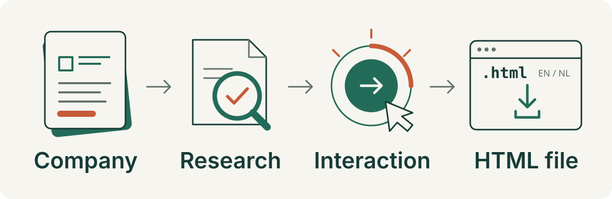

# Interactive experience generator

**Turn a company's story into something people can explore, not just read.**

A skill for Microsoft Copilot Cowork and other skill-enabled agents. Start with
a company or product; the agent researches official sources, develops concepts,
and builds your chosen direction as **one online-first HTML file**, using
official website content and real logo/image URLs. Offline packaging is
available when explicitly requested.



*Workflow illustration, not a screenshot of a generated experience.*

## What you get

A full-screen interactive experience rather than a conventional website or slide
deck. Each experience includes:

- **A company story you can interact with** — visitor actions reveal a sourced
  benefit or message, using actual permitted company assets.
- **English and Dutch** — with keyboard and touch access, plus reduced motion.
- **Sources and Download HTML buttons** — the default download keeps official
  online asset URLs and clearly states that internet access is required.
- **Offline export on request** — the agent tries to download and embed assets
  itself, without interrupting the working online version with upload requests.

Visual direction, interaction design, critique, and polish guidance are bundled.
A new offline inspiration library helps the agent choose interactions that fit
the visitor's goal. No separate design-skill installation is needed.

## Install

### Microsoft Copilot Cowork

1. Open the [skill package](dist/interactive-experience-generator.skill).
2. Choose **Download raw file**. This public download needs no GitHub sign-in.
3. Import the `.skill` file into Cowork. Re-import it after updates.

### Other agents

Copy these files and folders into an `interactive-experience-generator` folder
in your agent's skill location, preserving the directory structure:

```text
interactive-experience-generator/
  SKILL.md
  references/
  NOTICE.md
  licenses/
  scripts/
```

`SKILL.md` alone is not enough.

## Try it

After installing, ask your agent:

```text
Use interactive-experience-generator
to create an interactive experience
for [company or product].
Research official public sources.
Recommend a message and concepts
before building.
```

A company name is enough to start. Add a specific product, audience, or visitor
action if you already have one in mind.

**Research → choose → build → refine.** The agent recommends a source-backed
message, presents four concepts with visual previews, and builds the one you
select. It checks a representative interactive scene before expanding, then
reviews the result and downloaded HTML in its declared delivery mode. For revisions, it preserves approved
choices and changes the requested part instead of restarting.

## Built-in inspiration, from concept to review

The skill includes **30 curated patterns** informed by Codrops Creative Hub
and React Bits. The agent matches a visitor's goal — such as comparing,
discovering, or manipulating — to useful mechanisms, rather than picking effects
for decoration. It can read these references without browsing.

The generator's storytelling guidance, bundled Impeccable layout principles,
and Emil Kowalski's animation advice work together throughout:

| Stage | How the guidance is used |
| --- | --- |
| Concepts | Explain the layout, visitor action, visible result, motion purpose, and accessible alternatives for each option. |
| Build | Carry the selected ideas into responsive layout, feedback, motion, and recovery. Refine them in a working scene. |
| Review | Compare the actual experience with the approved choices, not just its appearance or source references. |

Each pattern records its source, review date, evidence limits, suitable uses,
avoid cases, and accessibility/offline guidance. These are original analytical
descriptions, **not copied components, model training, or tested demos**. They
support the brief; they do not replace official company research or assets.
See the [pattern index](references/pattern-library/INDEX.md).

## Important limits

Research and company assets must come from **publicly available resources**,
not private or internal material. Building needs an agent with research,
official-asset URL discovery, file-output, and visual-inspection capabilities; the skill
does not provide those tools or grant asset reuse rights.

Required official images, logos, packaging, and models must have verified
provenance and permitted use. The online page loads real official asset URLs;
local downloads are not a prerequisite. Missing usable assets still prevent
brand acceptance unless you explicitly approve a specific substitute.
Approving a concept does not approve drawn lookalikes.

The agent researches relevant accessible official pages, offerings, case
studies and imagery, not the entire website indiscriminately. It cannot
guarantee access to every page, image or PDF. Website restrictions, missing
URLs, CORS and reuse terms still apply; observed and unverified checks must
be distinguished.

**Download HTML does not mean offline export.** Online files disclose their
internet dependency. If you explicitly request offline/self-contained delivery,
the agent checks its retrieval tools, tries permitted downloads, embeds
dependencies and verifies a network-blocked replay. If that fails, it keeps
the working online version and reports the specific offline limitation.
It asks for files only if you explicitly request help supplying them.
These instructions cannot add missing tools or guarantee agent compliance.

Every experience visibly includes this disclaimer, with a Dutch equivalent:

> This experience is generated entirely with Microsoft Copilot Cowork based on publicly available resources and for demonstration purposes only.

## Under the hood

The detailed guidance stays in the skill, so you do not need to read it to start:

- [Full workflow and requirements](SKILL.md)
- [Visual direction](references/art-direction.md) and
  [interaction design](references/concepts-and-interaction.md)
- [Critique and polish](references/experience-critique-polish.md)
- [Offline pattern matching](references/pattern-library/INDEX.md) and
  [library maintenance](references/pattern-library/MAINTENANCE.md)
- [Sources and asset rules](references/sources-and-labeling.md)
- [Build and delivery checks](references/build-and-delivery.md)
- [Attribution and license terms](NOTICE.md)

Keep `NOTICE.md` and [`licenses/`](licenses/) with redistributed copies. The
bundled Impeccable guidance is an attributed, scoped adaptation, not the full
upstream skill or command suite. Optional external inspiration is not a runtime
dependency; check each project's terms before reusing its code.

<details>
<summary>Package contents and evaluation notes</summary>

The `.skill` file is a ZIP containing 19 files under
`interactive-experience-generator/`. Package only `SKILL.md`, `references/`,
`NOTICE.md`, `licenses/`, and `scripts/manage_patterns.py`. Exclude the README,
README assets, evaluations, generated experiences, and local artifacts.

For maintainers, run these commands from the repository root:

```powershell
python scripts\manage_patterns.py --check
python scripts\manage_patterns.py --search compare
python scripts\manage_patterns.py --package
```

`--check` validates stored records and local references; it does not test the
visuals. `--search` finds candidate patterns by text. `--package` validates,
rebuilds, byte-checks the archive against source, and updates README counts and
the SHA-256 below. Python is optional for using the library: reading and text
search are enough.

```text
5c8a7c0aca925e3803c08aac59be8fe1e57fecc3942c85233f7c77bf66a724a8
```

**Installed copies do not update themselves.** Weekly research is an app-local
automation, not part of the installed skill or a public update service. It leaves
local changes for review without committing or pushing. Reviewed updates must be
repackaged, redistributed, and re-imported. See
[library maintenance](references/pattern-library/MAINTENANCE.md).

[`evals/evals.json`](evals/evals.json) contains 39 evaluation prompts;
[`evals/files/`](evals/files/) holds a fictional SVG fixture. Neither is included
in the package. Their presence does not prove they passed or that Cowork
downloads were tested. Text-only answers cannot establish rendered visual
quality or interaction feel.

</details>
